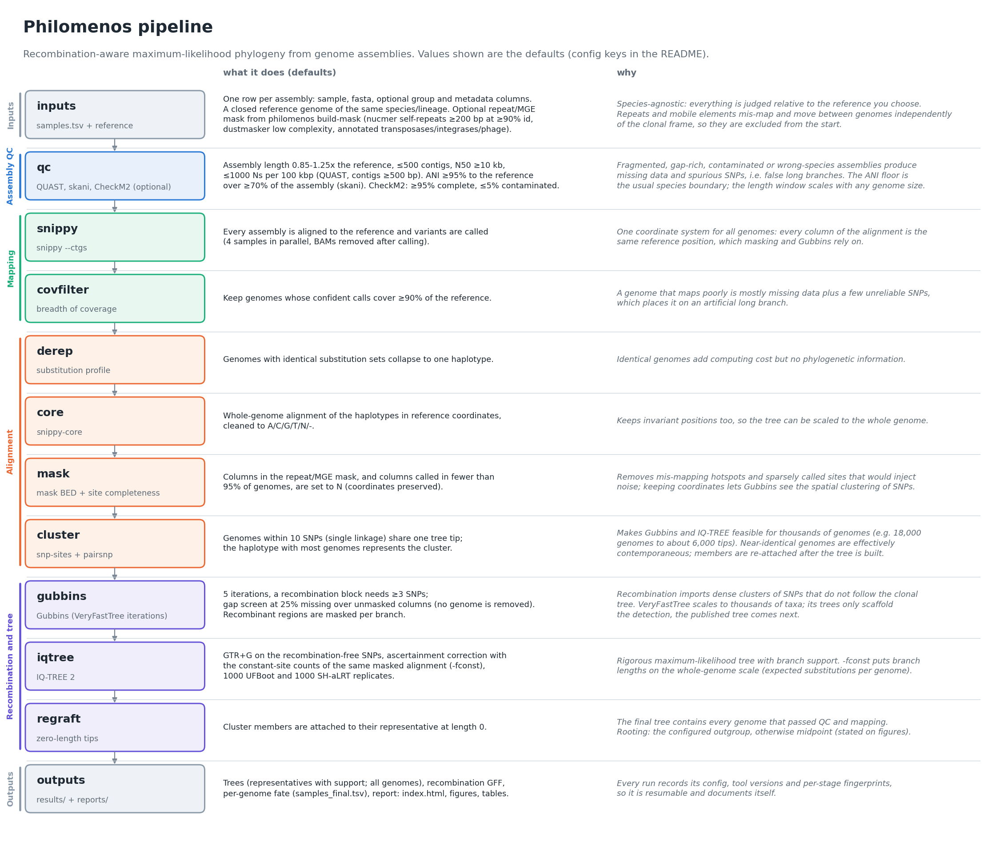

# Philomenos

Recombination-aware whole-genome phylogenetics for bacterial genome collections.

Philomenos takes a table of genome assemblies and a mapping reference, and
produces a maximum-likelihood phylogeny of the clonal frame: genomes are
quality-checked, mapped to the reference, reduced to a core alignment,
repeat/mobile-element regions and recombination are masked, and IQ-TREE 2
builds the tree. Every step is recorded in a resumable run directory, and a
single HTML report shows what was kept, what was removed and why.

- **Species-agnostic.** The only biological inputs are the assemblies, a
  reference genome of the same species or lineage, and (optionally) a mask BED
  for that reference. Nothing is tied to a genus, reference or genome length.
- **Pure phylogeny.** There is no molecular clock and no dating. Collection
  dates, if present, are ordinary metadata columns.
- **Scales to thousands of genomes.** Near-identical genomes are clustered into
  one tree tip and grafted back at the end. Philomenos streams the alignments
  it processes itself; snippy-core needs about 2.5 x haplotypes x reference
  length bytes of RAM (see Limitations).
- **Fails loudly.** A tool failure stops the run with the log path. There are
  no silent skips and no fallbacks that change the method.

## Pipeline



Every threshold shown is a config default and can be changed (see the
configuration reference below). The figure is generated from the code's defaults
by `python docs/make_pipeline_figure.py`, so it stays in sync with them.

In short:

```
samples.tsv + reference.fasta (+ mask BED)
   |
   qc         QUAST stats, skani ANI to the reference, optional CheckM2  -> passed.txt
   snippy     snippy --ctgs per assembly (bounded parallel)
   covfilter  drop genomes with low breadth of reference coverage        -> passed.txt
   derep      identical SNP profiles -> one haplotype
   core       snippy-core on haplotypes, cleaned to ACGTN-
   mask       mask BED regions + low-completeness columns -> N
   cluster    pairsnp distances, single linkage at N SNPs -> one tip per cluster
   gubbins    Gubbins (VeryFastTree iterations), recombination-masked alignment
   iqtree     IQ-TREE 2 on filtered SNPs, -fconst from the same masked alignment,
              UFBoot + SH-aLRT
   regraft    cluster members attached as zero-length tips
   |
results/ (trees, recombination GFF, per-sample table)  +  reports/index.html
```

## Install

Philomenos is a Python package (numpy, matplotlib, biopython, pyyaml) that
drives external tools. Each tool group lives in its own conda environment so
their pins never conflict; the config says which env provides which tool.

### Conda

```bash
git clone <this repository> philomenos && cd philomenos
for env in philomenos snippy gubbins pairsnp quast qc; do
    conda env create -f envs/$env.yml        # mamba/micromamba work too
done
conda env create -f envs/mask.yml            # only for `philomenos build-mask`
conda run -n philomenos pip install --no-deps -e .
conda activate philomenos
philomenos --version
```

| env file | provides (tool group in `tools.envs`) |
|---|---|
| `envs/philomenos.yml` | Python, numpy, matplotlib, biopython, pyyaml, pytest |
| `envs/snippy.yml` | snippy 4.6.0, snp-sites 2.5.1 (`snippy`) |
| `envs/gubbins.yml` | Gubbins 3.4.3, VeryFastTree 4.0.5, IQ-TREE 2.4.0 (`gubbins`, `iqtree`) |
| `envs/pairsnp.yml` | pairsnp 0.3.1 (`pairsnp`) |
| `envs/quast.yml` | QUAST 5.3.0 on Python 3.11 (`quast`) |
| `envs/qc.yml` | skani 0.3.1, CheckM2 1.1.0 on Python 3.12 (`skani`, `checkm2`) |
| `envs/mask.yml` | MUMmer 4.0.1, BLAST+ 2.12.0 dustmasker (`mask`) |

Then point the config at the envs by name (or by prefix path):

```yaml
tools:
  conda: conda
  envs: {snippy: snippy, gubbins: gubbins, iqtree: gubbins, pairsnp: pairsnp,
         quast: quast, skani: qc, checkm2: qc, mask: mask}
```

QUAST has its own env because QUAST 5.3.0 needs Python 3.11 while CheckM2
1.1.0 needs Python 3.12 or later, so they cannot share one.
CheckM2 is off by default; to use it, download its database once
(`conda run -n qc checkm2 database --download --path <dir>`) and set
`qc.checkm2: true` and `qc.checkm2_db`.

### Docker

```bash
docker build -t philomenos .
docker run --rm philomenos smoke --tools-from /opt/philomenos/tools.container.yaml --outdir /tmp/smoke
docker run -d --name philo --user "$(id -u):$(id -g)" -v "$PWD":/work philomenos run -c config.yaml
docker exec philo philomenos status runs/<name>
```

The image holds every env above. Copy the `tools:` block of
`/opt/philomenos/tools.container.yaml` (env names, shown in the `Dockerfile`)
into your config. Inside a container use `docker run -d` rather than
`philomenos run --detach`.

## Quickstart

```bash
philomenos init my_project.yaml          # commented example config
# edit: samples, reference.fasta, tools.envs (and any thresholds)
philomenos doctor -c my_project.yaml     # checks samples, reference, tools, disk space
philomenos run -c my_project.yaml --detach
philomenos status runs/my_run            # stage, progress, elapsed time, RAM, last log lines
philomenos report runs/my_run            # rebuild reports/ at any time
```

`philomenos run` is resumable: rerunning the same command skips completed
stages whose fingerprint (stage version, the config values it depends on, the
content of its input files, and the previous stage's fingerprint; the first
stage also covers every assembly and the reference) is unchanged and whose
outputs exist. If something changed, the run stops and names what changed;
recompute with `--force <stage>` or `--rerun-changed`, and every later stage is
recomputed too. With `--from`/`--only`, completed earlier stages are checked
against the current config as well, so a selection never builds on a stale
result. Only one `run` at a time can use a run directory: it holds a lock on
`<run>/.lock`, and a second `run` (or `run --detach`) on the same directory
stops with an error. See [docs/USAGE.md](docs/USAGE.md) for every command and
option.

## Inputs

**Samples table** (tab-separated, one row per assembly):

| column | required | meaning |
|---|---|---|
| `sample` | yes | unique id: letters, digits, `.`, `_`, `-` (`Reference` is reserved) |
| `fasta` | yes | assembly FASTA; relative paths resolve against the table's folder |
| `group` | no | colours the trees and figures (`report.group_column` can name another column) |
| anything else | no | metadata (country, host, collection_date, ...); `report.annotate` draws columns as dendrogram rings |

Empty cells are shown as missing in every figure, never dropped.
`philomenos fetch-ncbi samples.tsv samples.ncbi.tsv` adds BioSample metadata
(country, host, isolation source, collection date, strain) for NCBI assembly
accessions.

**Reference**: a closed genome of the same species or lineage (single or
multi-contig FASTA). Choose one close to the collection: the core alignment is
in its coordinates, and distant genomes lose breadth of coverage.

**Mask (optional but recommended)**: a BED of reference regions to exclude.
`philomenos build-mask -c my_project.yaml` builds one from nucmer
self-repeats, dustmasker low-complexity regions and, when `reference.genbank`
is set, mobile-element and prophage features; set `reference.mask_bed` to the
file it writes.

## Outputs

```
runs/<name>/
  run_config.yaml        the merged config the run used
  tool_versions.tsv      versions of every external tool and of philomenos
  status.json  run.log  run.pid  .lock (held while a run is active)
  logs/                  one log per tool call (logs/snippy_samples/<sample>.log per genome)
  work/<stage>/          stage outputs + .done.json (fingerprint, outputs, timings)
  results/
    tree_representatives.nwk  IQ-TREE ML tree, one tip per cluster, UFBoot/SH-aLRT support
    tree_all_samples.nwk      same tree with every genome (cluster members at zero length)
    recombination.gff         Gubbins recombination blocks (reference coordinates)
    samples_final.tsv         per genome: metadata, QC and coverage status, haplotype and
                              tree representative, in_tree, reason_excluded
    summary.json              counts per stage and key tree statistics
  reports/
    index.html           per stage: what was done, kept/removed counts, tables, figures
    tables/*.csv         step_counts, qc_metrics, coverage, variants_to_reference,
                         mask_composition, recombination_summary, tree_stats
    figures/*.png|pdf    qc, coverage, variants_to_reference, masking, recombination,
                         dendrogram, phylogram
```

Branch lengths in the trees are substitutions per modelled site; the
phylogram scale multiplies them by `site_counts.json:total_sites` (the sites
IQ-TREE modelled) and is labelled "expected substitutions per genome".
Recombination is summarised as the genome-wide r/m (total substitutions in
recombination blocks / total point mutations, over all branches) plus the
median per-branch r/m (over branches with m > 0). The rooting (outgroup or midpoint) is stated on every
figure.

## Configuration reference

Every key with the value `philomenos init` writes. Only `samples` and
`reference.fasta` are required; relative paths resolve against the config
file's folder. Unknown keys are an error.

| key | init value | meaning |
|---|---|---|
| `run.name` | `my_run` | output goes to `<outdir>/<name>/` |
| `run.outdir` | `runs` | parent folder of run directories |
| `run.threads` | `16` | threads for QUAST, skani, CheckM2, pairsnp, Gubbins and IQ-TREE (snippy uses `snippy.jobs` x `snippy.threads_per_job`) |
| `samples` | `samples.tsv` | samples table (see Inputs) |
| `reference.fasta` | `reference.fasta` | mapping reference |
| `reference.genbank` | `null` | annotation, used only by `build-mask` |
| `reference.mask_bed` | `null` | regions to exclude (BED, reference coordinates) |
| `tools.conda` | `conda` | conda/mamba executable used for `conda run` |
| `tools.envs.snippy` | `null` | env with snippy, snippy-multi, snippy-core, snippy-clean_full_aln, snp-sites |
| `tools.envs.gubbins` | `null` | env with run_gubbins.py, mask_gubbins_aln.py (and VeryFastTree) |
| `tools.envs.iqtree` | `null` | env with iqtree2 |
| `tools.envs.pairsnp` | `null` | env with pairsnp |
| `tools.envs.quast` | `null` | env with quast.py |
| `tools.envs.skani` | `null` | env with skani |
| `tools.envs.checkm2` | `null` | env with checkm2 (only if `qc.checkm2: true`) |
| `tools.envs.mask` | `null` | env with nucmer, show-coords, dustmasker (only for `build-mask`) |
| `qc.enabled` | `true` | `false` = every genome passes unchecked |
| `qc.quast_min_contig` | `500` | QUAST `--min-contig` |
| `qc.min_length_frac` | `0.85` | minimum assembly length / reference length |
| `qc.max_length_frac` | `1.25` | maximum assembly length / reference length |
| `qc.max_contigs` | `500` | maximum number of contigs |
| `qc.min_n50` | `10000` | minimum N50 (bp) |
| `qc.max_ns_per_100kbp` | `1000` | maximum Ns per 100 kbp |
| `qc.ani` | `true` | skani ANI check against the reference |
| `qc.min_ani` | `95.0` | minimum ANI (%) |
| `qc.min_aligned_frac` | `70.0` | minimum % of the assembly aligned to the reference |
| `qc.checkm2` | `false` | run CheckM2 |
| `qc.checkm2_db` | `null` | CheckM2 DIAMOND database (required when `qc.checkm2: true`) |
| `qc.min_completeness` | `95.0` | minimum CheckM2 completeness (%) |
| `qc.max_contamination` | `5.0` | maximum CheckM2 contamination (%) |
| `snippy.jobs` | `8` | genomes mapped in parallel |
| `snippy.threads_per_job` | `2` | threads per snippy job |
| `snippy.reuse_dir` | `null` | reuse per-sample snippy outputs from an earlier run |
| `covfilter.min_breadth` | `0.90` | minimum fraction of the reference confidently called |
| `mask.min_site_completeness` | `0.95` | columns called (ACGT) in fewer samples than this become N |
| `cluster.snp_threshold` | `10` | genomes within N SNPs share one tree tip (`0` = off) |
| `gubbins.iterations` | `5` | Gubbins `--iterations` |
| `gubbins.min_snps` | `3` | Gubbins `--min-snps` |
| `gubbins.filter_percentage` | `25.0` | Gubbins `--filter-percentage` (max % gaps per sequence; see Limitations) |
| `gubbins.seed` | `1` | Gubbins `--seed` |
| `iqtree.model` | `GTR+G` | substitution model (`+ASC` is dropped: `-fconst` supplies the constant sites) |
| `iqtree.ufboot` | `1000` | ultrafast bootstrap replicates (`0` = off; IQ-TREE needs >= 1000) |
| `iqtree.alrt` | `1000` | SH-aLRT replicates (`0` = off) |
| `iqtree.seed` | `1` | IQ-TREE `-seed` |
| `tree.outgroup` | `null` | sample id to root Gubbins, IQ-TREE and figures on; `null` = midpoint |
| `report.title` | `null` | report and figure title |
| `report.group_column` | `group` | samples-table column that colours the trees |
| `report.background_group` | `null` | group drawn in grey; `null` = the most common group |
| `report.annotate` | `[]` | extra columns drawn as dendrogram rings, e.g. `[country, host]` |
| `report.dpi` | `300` | PNG resolution |

## Method rationale

- **qc.** Wrong-species, contaminated or fragmented assemblies add false SNPs
  and long branches. Thresholds are relative to the reference length, so they
  carry over between species. skani ANI and aligned fraction catch genomes
  outside the reference's species or lineage; CheckM2 adds completeness and
  contamination when its database is available.
- **snippy (`--ctgs`).** Mapping assemblies to one reference gives every genome
  the same coordinates, so the core alignment, the mask and the recombination
  blocks all share one coordinate system.
- **covfilter.** A genome that covers too little of the reference contributes
  mostly missing data and distorts both Gubbins and the tree.
- **derep and cluster.** Identical haplotypes are merged first (exact); then
  genomes within `cluster.snp_threshold` SNPs (pairsnp, sparse) become one tip.
  At outbreak-level distances the tree cannot resolve their order anyway, and
  removing them keeps Gubbins and IQ-TREE tractable for thousands of genomes.
  The representative is the haplotype carrying most genomes.
- **mask.** Repeats and mobile elements produce mapping artefacts and move
  independently of the clonal frame; Gubbins removes recombination, not these.
  Columns called in too few genomes are masked so that the alignment is a core
  alignment. Masked columns become N, coordinates are kept.
- **gubbins.** Homologous recombination imports clusters of substitutions that
  violate the tree model. Gubbins finds them iteratively; VeryFastTree builds
  the per-iteration trees because they are only scaffolding and it scales to
  thousands of taxa. `mask_gubbins_aln.py` writes the recombination-masked
  alignment.
- **iqtree.** The ML tree is built on Gubbins' filtered polymorphic sites. A
  SNP-only alignment needs ascertainment correction: `-fconst` passes the
  constant-site composition counted (`snp-sites -C`) on the very alignment
  Gubbins masked, so variable and constant sites describe the same site space.
  Support is UFBoot and SH-aLRT.
- **regraft.** Cluster members are attached to their representative as
  zero-length tips, so the final tree lists every genome that passed.

## Limitations

- **Single-linkage clustering** chains: two genomes in one cluster can differ
  by more than `cluster.snp_threshold` SNPs if intermediate genomes connect
  them. Check `work/cluster/members.tsv` (and the report) when cluster sizes
  matter, or set the threshold to `0`.
- **Zero-length regrafting** places cluster members as a polytomy on their
  representative: their internal order and branch lengths are not estimated,
  and they carry no support values.
- **Gubbins on very diverse sets.** Gubbins assumes recombination imports
  happen against a mostly clonal background. On collections spanning several
  divergent lineages it can under-detect recombination between lineages and
  is memory hungry; run separate analyses per lineage when the collection is
  that diverse.
- **snippy-core memory.** `snippy-core` holds the whole core alignment in
  memory: peak RAM is about 2.5 x haplotypes x reference length bytes, e.g.
  about 180 GB for 18,000 haplotypes of a 4 Mb genome. Derep only merges
  identical haplotypes, so plan the core stage's machine accordingly or split
  very large collections.
- **Gubbins gap filter.** `gubbins.filter_percentage` is applied to the
  unmasked columns only: Philomenos rescales the value it passes to
  `--filter-percentage` so that columns set to N by the mask stage do not count
  as missing data. In Gubbins 3.4.3 this filter does not remove genomes from its
  outputs (every input sequence stays in the tree and the masked alignment); it
  only screens its internal checks.
- **Reference bias.** Regions absent from the reference (accessory genome) are
  not analysed, and genomes far from the reference lose coverage.
- **No dating.** Trees are in substitutions, not time; no clock signal is
  tested or assumed.

## Testing

```bash
pytest -m "not smoke"                                   # unit tests, seconds, no external tools
philomenos smoke --tools-from config/tools.local.yaml   # end-to-end run on synthetic data
PHILOMENOS_TOOLS_CONFIG=config/tools.local.yaml pytest -m smoke
```

`philomenos smoke` generates a small seeded synthetic dataset (two groups, a
planted recombination block, near-identical pairs and one low-coverage
genome), runs the whole pipeline on it, checks the results against the
simulation truth and prints a PASS/FAIL table. `--tools-from` takes the
`tools:` section of any config, e.g. a local file with your env paths.

## Citing

If you use Philomenos, cite it (see `CITATION.cff`) and the tools it runs:

- **snippy**: Seemann T. Snippy: fast bacterial variant calling from NGS reads. https://github.com/tseemann/snippy
- **snp-sites**: Page AJ et al. (2016) SNP-sites: rapid efficient extraction of SNPs from multi-FASTA alignments. *Microbial Genomics* 2:e000056.
- **Gubbins**: Croucher NJ et al. (2015) Rapid phylogenetic analysis of large samples of recombinant bacterial whole genome sequences using Gubbins. *Nucleic Acids Research* 43:e15.
- **VeryFastTree**: Piñeiro C, Abuín JM, Pichel JC (2020) Very Fast Tree: speeding up the estimation of phylogenies for large alignments through parallelization and vectorization strategies. *Bioinformatics* 36:4658-4659.
- **IQ-TREE 2**: Minh BQ et al. (2020) IQ-TREE 2: new models and efficient methods for phylogenetic inference in the genomic era. *Molecular Biology and Evolution* 37:1530-1534.
- **UFBoot2**: Hoang DT et al. (2018) UFBoot2: improving the ultrafast bootstrap approximation. *Molecular Biology and Evolution* 35:518-522.
- **SH-aLRT**: Guindon S et al. (2010) New algorithms and methods to estimate maximum-likelihood phylogenies: assessing the performance of PhyML 3.0. *Systematic Biology* 59:307-321.
- **pairsnp**: Tonkin-Hill G. pairsnp: pairwise SNP distance matrices. https://github.com/gtonkinhill/pairsnp
- **QUAST**: Gurevich A et al. (2013) QUAST: quality assessment tool for genome assemblies. *Bioinformatics* 29:1072-1075.
- **skani**: Shaw J, Yu YW (2023) Fast and robust metagenomic sequence comparison through sparse chaining with skani. *Nature Methods* 20:1661-1665.
- **CheckM2**: Chklovski A et al. (2023) CheckM2: a rapid, scalable and accurate tool for assessing microbial genome quality using machine learning. *Nature Methods* 20:1203-1212.
- **MUMmer4** (build-mask): Marçais G et al. (2018) MUMmer4: a fast and versatile genome alignment system. *PLoS Computational Biology* 14:e1005944.
- **BLAST+ dustmasker** (build-mask): Camacho C et al. (2009) BLAST+: architecture and applications. *BMC Bioinformatics* 10:421.

## Repository layout

```
src/philomenos/        the package (CLI, stages, report, build-mask, fetch-ncbi, smoke)
tests/                 pytest unit tests and the smoke test
envs/                  conda environments per tool group
docs/                  ARCHITECTURE.md (stage contract), USAGE.md (commands)
analyses/st492_paper/  study-specific material for one paper (not part of the tool)
Dockerfile             container with every env
```

## Licence

GPL-3.0-or-later; see [LICENSE](LICENSE).
